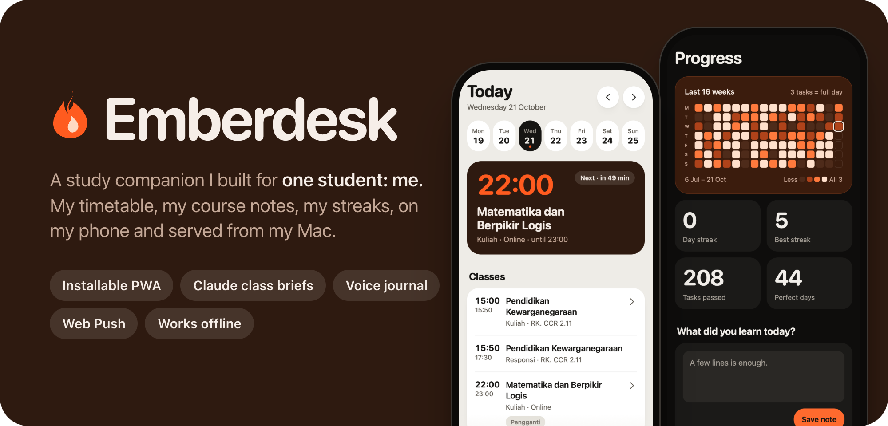
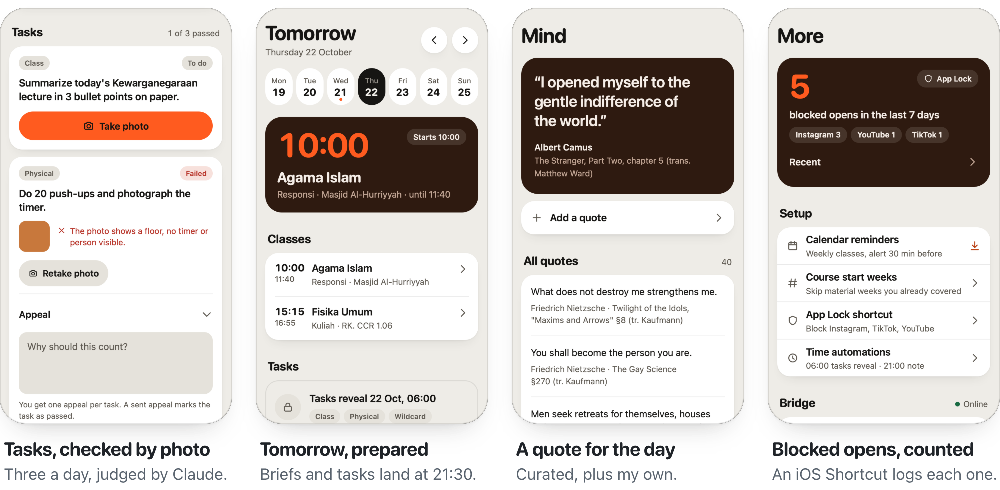
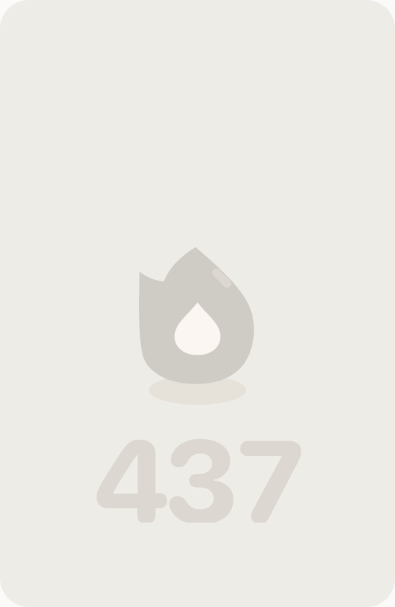
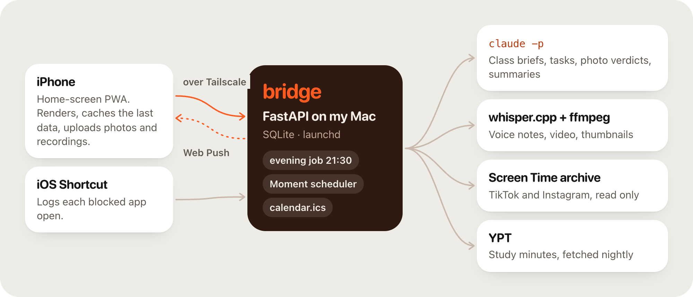

<p align="center">
<picture>
  <source media="(prefers-color-scheme: dark)" srcset="docs/readme-assets/hero-dark.png">
  
</picture>
</p>

<p align="center">
  
  
  
  
  
</p>

**Emberdesk** is the study app on my phone. It knows my university timetable, reads my course slides the evening before each class, gives me three small tasks a day that I prove with a photo, and keeps a journal that pings me once a day at a random time. It runs as a home-screen PWA, served by a small Python bridge on my Mac and reachable only over my Tailscale network.

> [!NOTE]
> This is a personal tool, published as a portfolio piece. It is not a template: the timetable, course list and launchd paths are mine, and setting it up for someone else would mean replacing most of them.

## A day with it

<p align="center">
<picture>
  <source media="(prefers-color-scheme: dark)" srcset="docs/readme-assets/gallery-dark.png">
  
</picture>
</p>

- **Today, Tomorrow, any day.** A week strip over the next class, built from a weekly timetable. Cancelled classes and replacement sessions (*pengganti*) are handled, and a cancelled week's material moves to the next session.
- **Class briefs.** `claude -p` reads that week's lecture PDF and writes key ideas, three questions and terms. An evening job at 21:30 prepares tomorrow.
- **Tasks with photo proof.** Three tasks a day (class, physical, wildcard), revealed at 06:00. A photo is judged by Claude; one appeal per task.
- **Journal and Moment.** Text, photo, video and voice entries. Voice notes are transcribed on the Mac with whisper.cpp. A daily Moment arrives as a Web Push at a random time, 09:00 to 21:00 by default.
- **Streaks.** Task and Moment streaks, a 16-week heatmap, and a full-screen celebration when a day is earned.
- **Study and screen time.** Study minutes from YPT, TikTok and Instagram time from the Mac's Screen Time archive, and Claude's ideas for what the same hours could go to instead.
- **Small things.** A calendar feed with 30-minute alerts, an App Lock log fed by an iOS Shortcut, offline reading, and light and dark themes that are both first-class.

## The one celebration

Everything else in the app is quiet: tabs switch instantly, and nothing loops. The exception is the day a streak is earned. A 4.7-second flame, drawn in SVG and driven by the Web Animations API with no libraries, rolls the count over and shows the week. It plays once per streak per day. With reduced motion on, you get the final frame and nothing moves. The capture below is the real prototype, stepped frame by frame. The timeline is in [`design/streak-motion-spec.md`](design/streak-motion-spec.md).

<p align="center">
  <picture>
    <source media="(prefers-reduced-motion: reduce) and (prefers-color-scheme: dark)" srcset="docs/readme-assets/streak-dark.png">
    <source media="(prefers-reduced-motion: reduce)" srcset="docs/readme-assets/streak-light.png">
    <source media="(prefers-color-scheme: dark)" srcset="docs/readme-assets/streak-dark.gif">
    
  </picture>
</p>

## How it fits together

<p align="center">
<picture>
  <source media="(prefers-color-scheme: dark)" srcset="docs/readme-assets/architecture-dark.png">
  
</picture>
</p>

| Layer | Choice |
|---|---|
| Frontend | Static PWA in [`web/`](web): vanilla JS, no build step, a service worker, KaTeX for maths |
| Backend | Python 3.12+, FastAPI, SQLite (stdlib `sqlite3`), run with `uv`, in [`bridge/`](bridge) |
| AI | The `claude` CLI in print mode, with shell and write tools disallowed and no MCP servers |
| Media | whisper.cpp for transcription, ffmpeg for audio and video |
| Notifications | Web Push with VAPID keys (`pywebpush`) |
| Hosting | My Mac, launchd, `tailscale serve`; nothing public |
| Tests | pytest in [`bridge/tests`](bridge/tests), Node's test runner in [`tests-web`](tests-web) |

## Design notes

The app has a written design system and a paper trail for the larger decisions.

- [`DESIGN.md`](DESIGN.md): colour roles, tokens, type, motion rules and every component. One warm slab per screen; orange means act or data.
- [`SPEC.md`](SPEC.md): the build contract, schema and API.
- [`design/streak-motion-spec.md`](design/streak-motion-spec.md): the streak celebration, beat by beat.
- [`docs/plans/`](docs/plans): the journal contract and review, and the streak animation decision.
- [`docs/screen-time.md`](docs/screen-time.md) and [`docs/frontend-quality.md`](docs/frontend-quality.md): integration notes and the frontend quality pass.
- `design/mockup.html` and `design/streak-motion.html` are interactive prototypes; download and open them in a browser.

## Running it

It is not supported for anyone but me. To look around and run the tests:

```sh
git clone https://github.com/Subakiz/Emberdesk.git
cd Emberdesk
(cd bridge && uv run pytest)
node --test tests-web/*.test.cjs
```

## Credits

[KaTeX](https://katex.org) is vendored for maths in briefs. Screen Time import uses [screentime-archive](https://github.com/tobias-x/screentime-archive) (MIT) at a pinned revision. The streak celebration's beats were measured from a screen recording of a mobile streak reward, then redrawn in hand-written SVG.

Released under the [MIT License](LICENSE).
