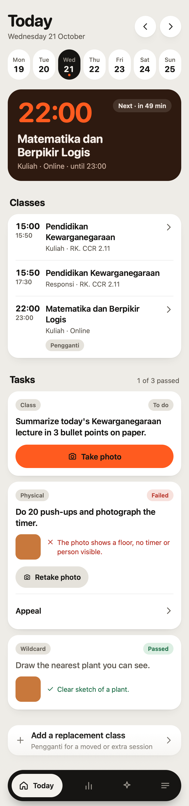

# Boredom-Maxxing

A personal study companion PWA, built for one user (me): my university timetable, my Mac, my Tailscale network. Published as a portfolio piece, not as a template. Paths in `bridge/launchd/` and `.env.example` are hardcoded to my machine.

## What it does
- **Today / Tomorrow / Saturday** views built from a weekly class timetable (`bridge/seed/schedule.json`), with cancel and replacement-class handling.
- **Class briefs** generated by `claude -p` from my course materials, and an evening job (21:30) that prepares the next day.
- **Journal**: a daily Moment with voice (Whisper transcription), photo and video entries, plus a streak with a full-screen celebration animation.
- **Screen time** tracking with suggested time equivalents, and study stats pulled from YPT.
- **Web Push** reminders, offline support via a service worker, light and dark themes.

## Stack
- Frontend: static PWA, vanilla JS, no build step (`web/`). KaTeX vendored for math.
- Backend: Python 3 / FastAPI / SQLite in `bridge/`, run with `uv`, kept alive by launchd, reachable only over Tailscale.
- Tests: pytest (`bridge/tests`) and Node (`tests-web`).

## Design notes
- `SPEC.md`: build contract and schema.
- `DESIGN.md`: visual and motion design.
- `design/`: motion specs and HTML prototypes.
- `docs/`: plans and research.

## Running it
Not supported for anyone but me. If you want to poke around: `cd bridge && uv run pytest`.

MIT licensed.
